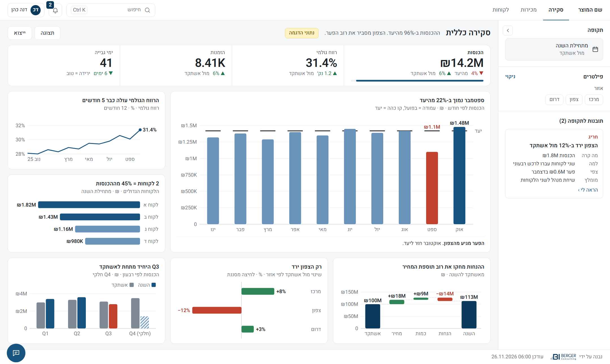
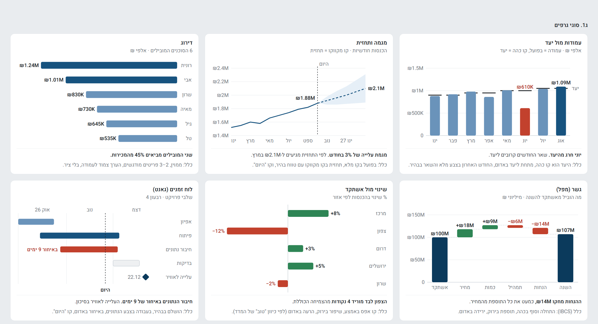
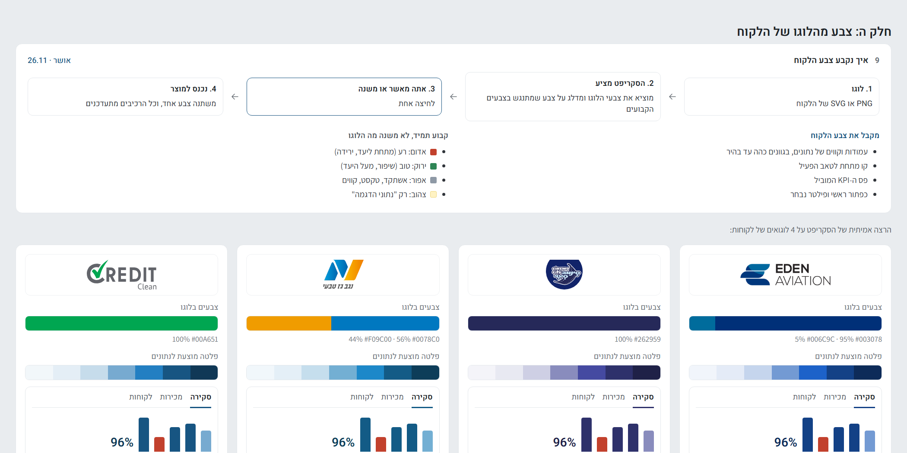
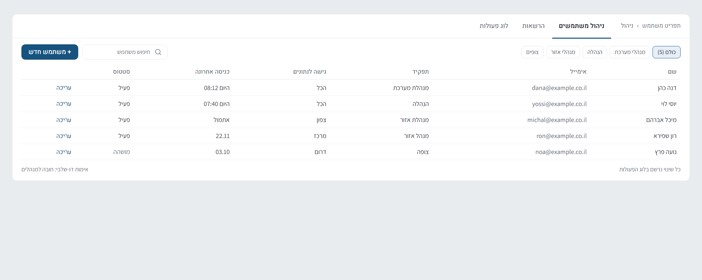
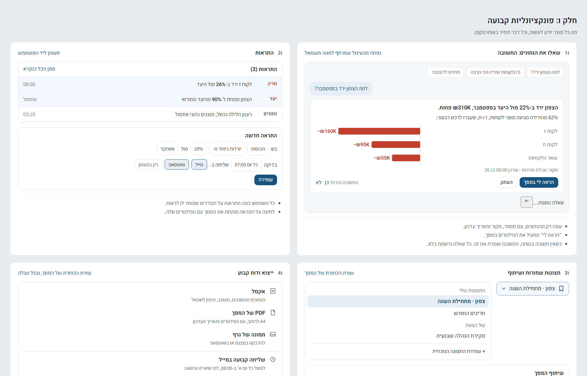
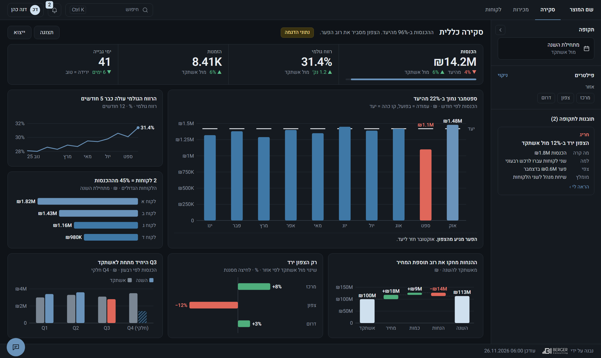
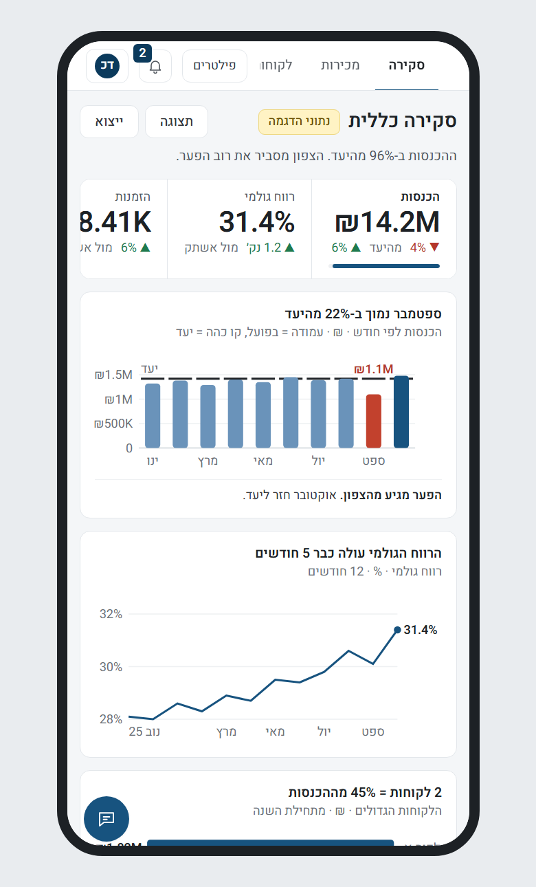

<div dir="rtl" align="center">

# שפת Berger BI

**השפה החזותית והפונקציונלית של כל דמו ומוצר BI שאנחנו בונים.**<br>
סקיל ל-Claude, ערכת עיצוב, ספריית גרפים ומסך פתיחה מוכן, בעברית ומימין לשמאל.

[](https://github.com/bergerbi/berger-bi-ui/actions/workflows/check.yml)


**[פתיחת הדמו החי](https://bergerbi.github.io/berger-bi-ui/skills/berger-bi-ui/starter.html)** · **[הרפרנס המלא](https://bergerbi.github.io/berger-bi-ui/)** · [התקנה](#התקנה) · [מסך חדש ב-3 צעדים](#מסך-חדש-ב-3-צעדים) · [איך משנים](#איך-משנים)

<br>



</div>

<div dir="rtl">

## מה מקבלים

<table>
<tr>
<td width="50%" valign="top"><br><b>ספריית גרפים בשורה אחת</b><br>עמודות מול יעד, מגמה ותחזית, גשר, שינוי מול אשתקד, דירוג וגאנט. צירים אמיתיים, טולטיפ עם השוואה, ותוויות שלא עולות זו על זו. אדום = רע, ירוק = טוב, כמו בתקן IBCS.</td>
<td width="50%" valign="top"><br><b>צבע הלקוח מתוך הלוגו</b><br>סקריפט קורא את הלוגו ומציע פלטה. הוא מדלג על צבעים שמתנגשים באדום ובירוק ובודק ניגודיות. משנים שורה אחת, וכל המסך מתעדכן.</td>
</tr>
<tr>
<td valign="top"><br><b>ניהול מובנה</b><br>משתמשים, מטריצת הרשאות ולוג פעולות, תמיד בתפריט המשתמש ובכל מוצר אותו דבר.</td>
<td valign="top"><br><b>פונקציונליות קבועה</b><br>שאלו את הנתונים, התראות, תצוגות שמורות, ייצוא, הגדרת מדד, סינון מתוך גרף, סיור מודרך, יעדים וספים.</td>
</tr>
</table>

<table>
<tr>
<td width="70%" valign="top"><br><b>מצב כהה למוצרים</b>, שנבנה מאותם צבעי לקוח.</td>
<td width="30%" valign="top"><br><b>טלפון וטאבלט</b>: הפילטרים נשלפים מלמטה.</td>
</tr>
</table>

## העקרונות בקצרה
- **שלד קבוע:**
  - טאבים למעלה.
  - פאנל ימני: תקופה, פילטרים ותובנות. הפאנל מתכווץ.
  - פס KPI, ומתחתיו 6 ויז'ואלים. הראשי תופס 2×2.
  - ניהול נמצא רק בתפריט המשתמש.
  - בשורה התחתונה: "נבנה על ידי Berger BI".
- **בלי גלילה** ב-1440×900 וב-1920×1080.
- **3 גדלי טקסט ועוד גודל למספרי KPI:** 12 / 13 / 19 / 28. אין טקסט קטן מ-12.
- **צבע:**
  - הנתונים בצבע של הלקוח.
  - אדום = רע, ירוק = טוב.
  - אשתקד באפור, יעד בקו כהה.
- **לא נראה כמו AI:** בלי צללים, גרדיאנטים, תגיות פסטל, אימוג'י ופסים צבעוניים.
- **תובנה בנויה תמיד כך:** מה קרה, למה, צפי, מומלץ, והראה לי.

## מה יש בריפו
| | |
|---|---|
| `skills/berger-bi-ui/SKILL.md` | הליבה ש-Claude קורא, 40 שורות. קל וזול בטוקנים |
| `skills/berger-bi-ui/starter.html` | מסך פתיחה מוכן. כל דמו מתחיל ממנו |
| `skills/berger-bi-ui/tokens.css` | צבעים, גדלים ורכיבים (לא עורכים לכל לקוח) |
| `skills/berger-bi-ui/client.css` | צבע הלקוח: הקובץ היחיד שמשנים לכל לקוח |
| `skills/berger-bi-ui/bbi-charts.js` | ספריית הגרפים, בלי תלויות |
| `skills/berger-bi-ui/bbi-shell.js` | תפריטים, פאנל מתכווץ, שמירת פילטרים, צ'אט והודעות |
| `skills/berger-bi-ui/bbi-audit.js` | בדיקה אוטומטית של הכללים, בלי מודל ובלי טוקנים |
| `skills/berger-bi-ui/logo_palette.py` | צבע לקוח מהלוגו |
| `skills/berger-bi-ui/docs/` | הכללים המלאים, גרפים ומוצר. Claude קורא אותם רק כשצריך |
| `tools/audit.mjs` | בודק את המסך בדפדפן אמיתי בכל הגדלים, ורץ ב-GitHub על כל העלאה |
| `evals/` | 3 בדיקות קבועות לסקיל ויומן תוצאות |
| `index.html` / `reference.html` | הרפרנס הוויזואלי, נבנה מ-`src/` |

## התקנה
**כל הצוות דרך claude.ai (מומלץ):**
1. בעל הארגון נכנס להגדרות הארגון, ל-**Plugins & skills**.
2. לוחצים **Add**, ואז **Sync from GitHub**, ובוחרים את `bergerbi/berger-bi-ui`.
3. מסמנים **Installed by default** ו-**Sync automatically**.

מאותו רגע כולם מקבלים את הסקיל, גם באתר וגם ב-Claude Code, וכל שינוי בריפו מגיע אליהם לבד.

**Claude Code בלבד:**
```
claude plugin marketplace add bergerbi/berger-bi-ui
claude plugin install berger-bi-ui@berger-bi
```
את העדכון האוטומטי מפעילים בתוך Claude Code: פותחים את `/plugin`, נכנסים ללשונית Marketplaces ומדליקים auto-update.

## מסך חדש ב-3 צעדים
1. מבקשים מ-Claude: *"תבנה דמו ללקוח X בשפת Berger BI"*. הוא מעתיק את `starter.html` ואת הקבצים שלידו.
2. *"תיקח את הצבע מהלוגו הזה"*. הוא מריץ את `logo_palette.py`.
3. פותחים את הדף עם `#audit`. רשימה ריקה אומרת שהדף עומד בכללים.

## איך משנים
**כל אחד בצוות משנה ישירות. אין צורך באישור.**
1. מבקשים מ-Claude את השינוי, למשל *"תוסיף לספריית הגרפים גרף פיזור"*.
2. Claude מוסיף שורה ל-`CHANGELOG.md` ומריץ `python -I tools/build_reference.py`.
3. Commit ו-push ל-`main`.

**שומרים על הסדר בלי אישורים:**
- בדיקה אוטומטית ב-GitHub רצה על כל העלאה. היא בודקת שה-JS תקין, שהסקיל נשאר קל, שהדפים הבנויים תואמים למקור, ופותחת את המסך בדפדפן אמיתי ב-21 מצבים. אדום ב-GitHub = משהו נשבר; מתקנים ומעלים שוב.
- גרפים חדשים נכנסים ל-`bbi-charts.js` כאן ולא בעותק של פרויקט.
- כלל חדש מגיע עם שורה ביומן שמסבירה איזו בעיה אמיתית הוא פותר.

**בדיקת הסקיל אחרי שינוי:** שלוש בקשות, ומה צריך לקרות בכל אחת:
- "תבנה מסך סקירה ללקוח": הסקיל נטען.
- "תכתוב מדד DAX": הסקיל לא נטען.
- "תשנה את צבע הגרף": נקרא רק `docs/charts.md`.

</div>
